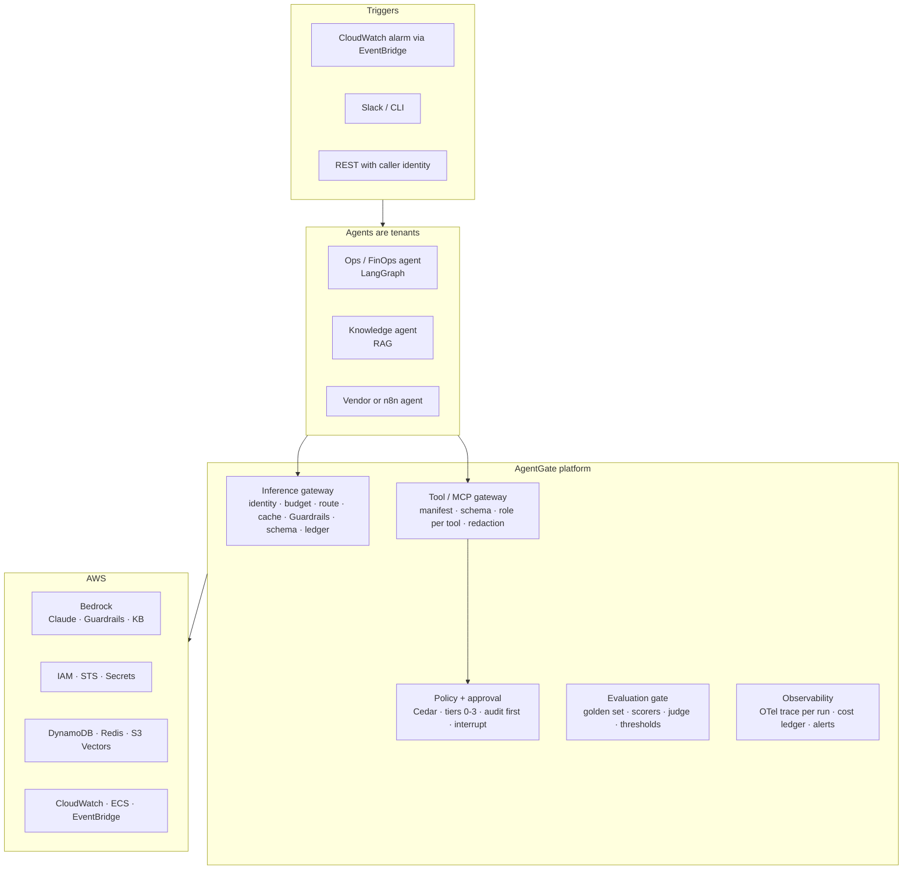
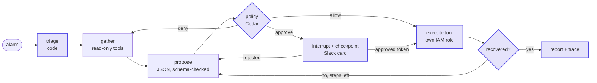
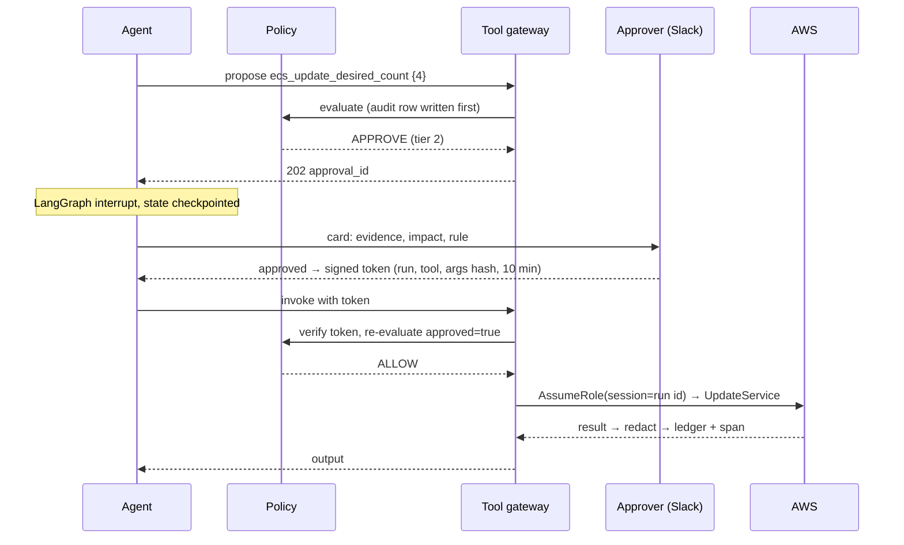

# AgentGate — a governed agent platform on AWS

[](https://github.com/amol-jadhav-aws/agentgate/actions/workflows/ci.yml)
 

Every team that calls Amazon Bedrock directly gets the same four problems: nobody knows what an agent costs,
nobody can stop it taking a dangerous action, nobody can prove why it did what it did, and nobody notices
when a prompt change makes it worse. AgentGate is the platform layer that fixes all four, built the way an
AWS Solutions Architect would build it for a company with many agent teams:

| Problem | AgentGate answer | Where |
|---|---|---|
| Unknown, unbounded spend | **Inference gateway**: callers ask for a *capability*, never a model. Token budgets per tenant and per run, enforced atomically before the call. Cost allocation tags on every row. Semantic cache. | `src/agentgate/gateway/` |
| Agents holding broad AWS credentials | **Tool / MCP gateway**: one IAM role per tool, assumed per call with the run id in the session name. Output redaction. The agent never sees a credential. | `src/agentgate/toolgateway/` |
| No control over dangerous actions | **Policy as code** (Cedar): allow / deny / approve per call, risk tiers 0–3, audit row written *before* the action. **Human approval** pauses the agent at a checkpoint (LangGraph `interrupt`) and resumes with a signed, single-use, argument-bound token. | `policies/`, `toolgateway/policy.py`, `approvals.py` |
| Silent quality regressions | **Evaluation gate in CI**: a golden set runs through the real gateway on every PR; `thresholds.yaml` is the contract; a drop blocks the merge with a readable diff. | `evals/`, `.github/workflows/ci.yml` |

Two reference agents prove the platform: an **Ops/FinOps agent** that handles a CPU-spike incident end to end
(with a human approving the scale-out) and a **Knowledge agent** that answers only from the tenant's documents
and refuses when it cannot.

## 60-second demo (no AWS account needed)

```bash
git clone https://github.com/amol-jadhav-aws/agentgate && cd agentgate
make install                     # pip install -e ".[dev]"
make test                        # 52 tests, offline
make eval                        # the evaluation gate: 5 suites, 44 golden cases -> PASS
make demo                        # CPU spike -> agent gathers evidence -> proposes scale-out -> PAUSES for approval
```

The demo stops at:

```
=== APPROVAL NEEDED ===
run 3f9c…  approval afa1606939
ecs_update_desired_count {"cluster": "demo", "service": "orders-api", "desired_count": 4}
why: CPU at 93% for the whole window with 2 tasks; add two tasks, reversible.
impact: desired_count 2 -> 4; cost +2 tasks until load drops
```

Run `make demo APPROVE=amol` to approve inline and watch it scale, re-check the metric, and report:
`recovered: true`, one model call, five tool calls, `total_cost_usd: 0.0026`, every step audited.

Then try the gate doing its job:

```bash
./scripts/sabotage_pr.sh         # routes propose_action to the cheapest model, drops the "never destructive" line
make eval                        # FAIL: never_destructive 0.50 < 1.00, tool_choice_accuracy 0.50 < 0.90
```

Local mode uses a deterministic fake for Bedrock and an in-memory AWS world (`toolgateway/tools/fakeaws.py`).
Set `AGENTGATE_MODE=aws` and the same code calls Bedrock Converse, DynamoDB, ElastiCache and STS.

## Architecture



**One agent run** (filled = deterministic code, plain = model call through the gateway):



**Inside the inference gateway** — seven checks: identity → budget (atomic DynamoDB `ADD` with a condition) →
route (capability → model tier) → semantic cache (cosine ≥ 0.95 on the final user turn; tenant, capability,
prompt version, model, context hash and system prompt in the exact key) → Bedrock Converse + Guardrails →
validate against the caller's JSON schema, one retry on the fallback model → record (ledger row + OTel span).
Callers never name a model, so budgets and tags cannot be skipped.

**A tool call that needs approval**:



Six full-size diagrams with explanations are in [`docs/architecture.md`](docs/architecture.md); decisions are in
[`docs/adr/`](docs/adr/).

## Repository layout

```
src/agentgate/
  common/        config, store (DynamoDB | memory), ledger + budgets, telemetry, redaction
  gateway/       inference gateway: identity, routing, cache, bedrock client (+ deterministic fake), validation, FastAPI app
  toolgateway/   manifest, Cedar policy engine, approvals, STS per-tool sessions, executor, tools/, FastAPI app, MCP server
  agents/        platform client, Ops/FinOps agent (LangGraph), Knowledge agent, CLI
  evals/         runner, scorers (deterministic + judge)
config/          capabilities.yaml (routing + prices), tools.yaml (manifest + grants), budgets.yaml, thresholds.yaml
policies/        tools.cedar
evals/golden/    classify, extract_json, propose_action, answer_grounded, policy  (JSONL)
infra/terraform/ modules: network, dynamodb, redis, ecs_service, iam_tool_roles, github_oidc · envs/dev
.github/         ci.yml (lint, tests, eval gate, policy tests, terraform validate) · deploy.yml (OIDC, no stored keys)
scripts/         chaos_cpu_spike, chaos_cost_spike, sabotage_pr, seed_budgets
docs/            architecture, ADRs 0001–0008, runbook
tests/           52 tests: gateway, policy, tool gateway + approvals, agents, evals, store atomicity, redaction
```

## Running the services

```bash
make up                                   # gateway :8080, tool gateway :8081, Jaeger UI :16686, Redis, DynamoDB Local
curl -s -H 'X-API-Key: dev-key-ops' localhost:8080/v1/capabilities | jq
curl -s -H 'X-API-Key: dev-key-ops' localhost:8080/v1/chat -d '{"capability":"classify","messages":[{"role":"system","content":"Labels: cpu_saturation, cost_anomaly, unknown"},{"role":"user","content":"CPU alarm fired"}]}' -H 'content-type: application/json' | jq
agentgate demo cpu                        # talks to the running services (drop --inproc)
agentgate approve <approval_id> --as amol
agentgate ask "When should I scale out an ECS service?"
agentgate budget; agentgate audit
python -m agentgate.toolgateway.mcp_server --tenant ops-agent     # same tools over MCP (pip install mcp)
```

Traces: one trace per run in Jaeger with a span per model and tool call, each carrying `agentgate.run_id`,
tenant, feature, cost and the policy decision.

## Deploying to AWS

```bash
cd infra/terraform/envs/dev && terraform init && terraform apply     # ~12 min; VPC, endpoints, Fargate x2, Redis, DynamoDB, roles, budget
terraform output deploy_role_arn   # -> GitHub repo variable AWS_DEPLOY_ROLE_ARN; deploy.yml then pushes on every merge to main
make destroy                       # after each session; the dev stack is sized to stay under USD 40/month
```

Design points of the deployment: all AWS calls go through VPC endpoints (no NAT), Fargate Spot, ARM64 tasks,
one DynamoDB on-demand table, `cache.t4g.micro` Redis, Haiku by default with Sonnet only for `propose_action`,
and an AWS Budget at 80% of USD 40 e-mails before anything surprises you.

## Key design decisions (full text in `docs/adr/`)

1. **Policy is deterministic code, never a prompt.** Cedar evaluates two actions, `invoke` and `auto_execute`; the pair maps to allow / deny / approve. A model can be persuaded; a policy cannot.
2. **Own gateway over LiteLLM.** ~600 lines gives capability routing, atomic budgets, a context-aware cache key and schema retry, with nothing we do not understand in the request path.
3. **Cache key vs. similarity.** Everything that must match exactly (tenant, capability, prompt version, model, retrieved-context hash, system prompt) is in the key; only the final user turn is embedded. The eval gate found the bug this fixes.
4. **One IAM role per tool, run id in the session name.** CloudTrail, the ledger and the trace join on one id.
5. **Cedar in-process via `cedarpy`; Amazon Verified Permissions as the managed path.** Same policy text either way.
6. **Deterministic triage before any model call.** An alarm's metric name picks the runbook family; a model only classifies free text.
7. **Deterministic scorers first, a judge model only for groundedness**, at temperature 0, with its own cost ceiling.
8. **The gateway owns the cost ledger.** No agent can forget to log a call, because the agent never makes one.

## Status

Local mode: complete and tested. AWS mode: Bedrock Converse, DynamoDB, STS and Terraform paths implemented;
the knowledge base, guardrail and ADOT exporter are wired through variables and left for the account owner to
provision (see `docs/runbook.md`).

---

Built by [Amol Jadhav](https://www.linkedin.com/in/amol-jadhav-aws) · AWS Certified Solutions Architect – Professional ·
GenAI & Agentic AI platforms on AWS. Questions and PRs welcome.
