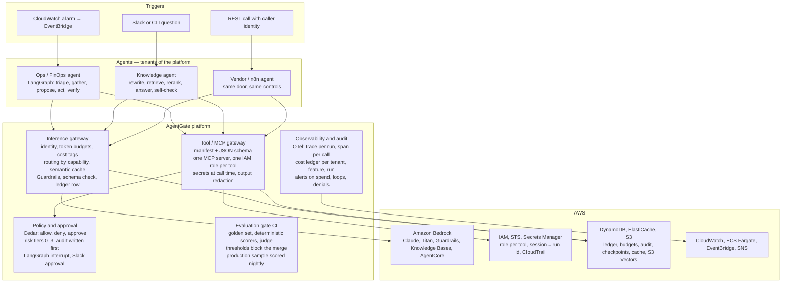
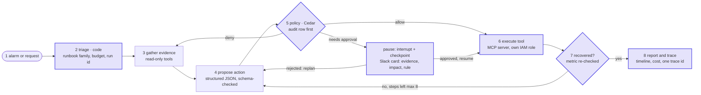
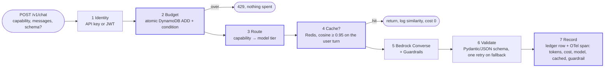
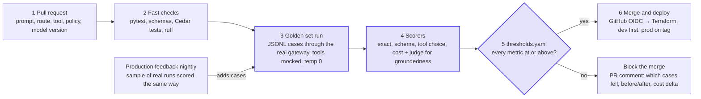
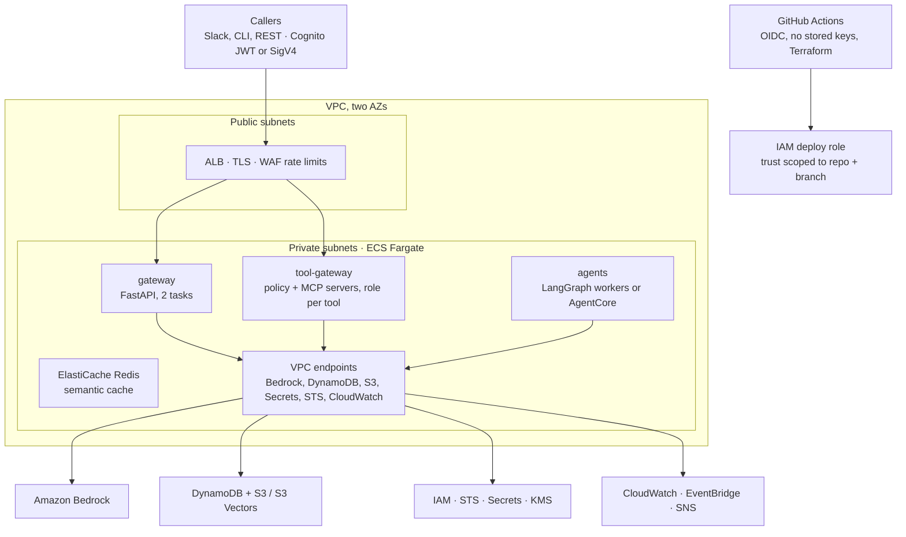

# AgentGate architecture

Six views. The platform is one idea applied five ways: an agent is a tenant, and every path from a tenant
to a model or to AWS passes through code the platform owns.

## 1. System architecture



Add a fourth agent, or a vendor's, and nothing in the platform changes except a tenant entry in
`config/tools.yaml` (grants) and `config/budgets.yaml`.

## 2. One agent run



Filled boxes are code with no model. Only step 4 calls a model, and its output must satisfy `ACTION_SCHEMA`
or the gateway rejects it before the agent ever sees it.

## 3. Inside the inference gateway



Cache key = `tenant | capability | prompt_version | model | context_hash | sha(system + earlier turns)`.
Only the final user turn is embedded and compared by similarity.

## 4. A tool call that needs approval

```mermaid
sequenceDiagram
  autonumber
  participant A as Agent (LangGraph)
  participant P as Policy engine
  participant T as Tool gateway
  participant H as Approver (Slack / CLI)
  participant W as AWS API
  A->>T: propose action JSON
  T->>P: evaluate(invoke, auto_execute) — audit row written first
  P-->>T: APPROVE (tier 2)
  T-->>A: 202 {approval_id}
  Note over A: interrupt(): state checkpointed, graph paused
  A->>H: card: evidence, expected impact, the rule
  H-->>A: approved → signed token: run id, tool, args hash, approver, 10-min expiry
  A->>T: invoke with approval_token
  T->>P: verify token (signature, expiry, run, tool, args), consume, re-evaluate approved=true
  P-->>T: ALLOW
  T->>W: AssumeRole(session name = run id) → execute
  W-->>T: result; CloudTrail event carries the run id
  T-->>A: redacted output + OTel span
```

Tier 0 and 1 skip steps 3–7. A deny at step 2 returns the rule to the agent. An expired, reused or
argument-changed token fails at step 9.

## 5. The CI evaluation gate



## 6. AWS deployment



Dev ceiling USD 40/month: Fargate Spot, ARM64, `cache.t4g.micro`, on-demand DynamoDB, Haiku by default,
`make destroy` after each session.
